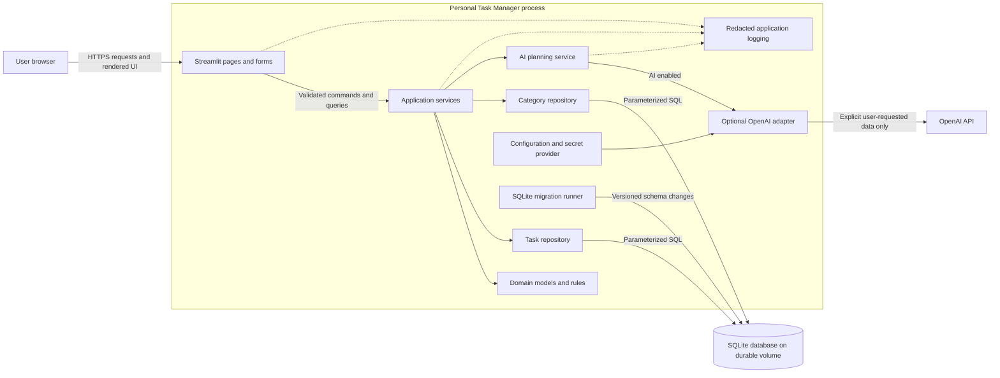
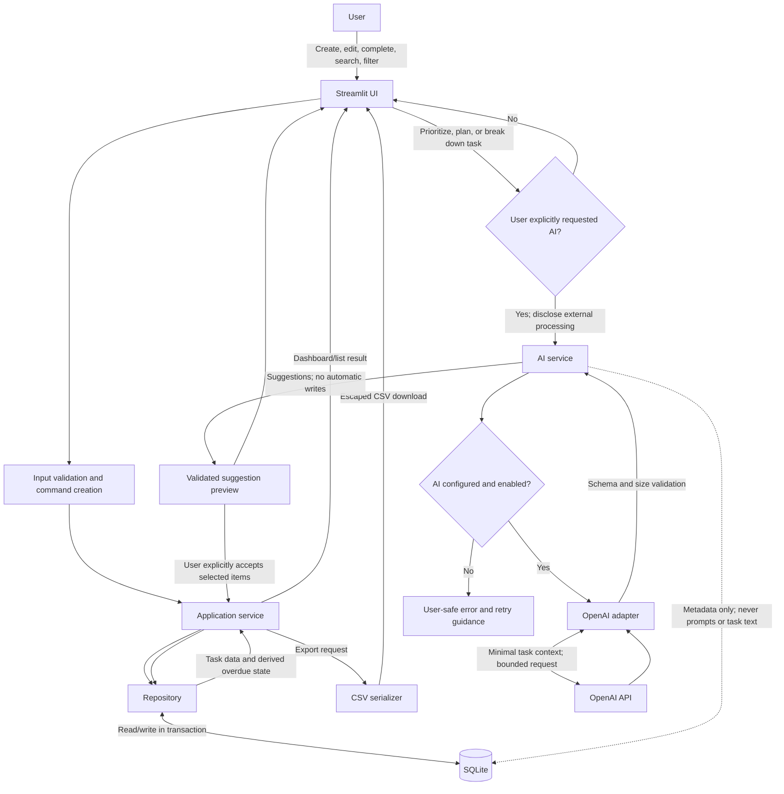

# Production Architecture

## Personal Task Manager with AI Prioritization

| Property | Decision |
|---|---|
| Application shape | Single-user, server-rendered Streamlit application |
| Runtime | Python |
| Persistence | SQLite on a durable local volume |
| AI | Optional OpenAI integration behind a provider interface |
| Testing | Pytest |
| Primary constraint | Preserve full manual task-management functionality when AI is unconfigured or unavailable |

This architecture reflects the current personal-use scope in [PRD.md](./PRD.md). SQLite is appropriate for a single-user deployment with modest write concurrency. It is not a shared database for multiple application replicas; move to a server database before expanding to concurrent users or horizontally scaled deployment.

## 1. High-Level Architecture

The application is a modular monolith. Streamlit renders the UI and invokes application services; services implement use cases and transaction boundaries; repositories own SQL and map database rows to domain models. SQLite is the source of truth for tasks and categories. AI is an optional outbound adapter used only when a user explicitly requests an AI feature.

```text
Browser
  │ HTTPS
  ▼
Streamlit UI ──► Application services ──► Domain rules
                       │                      │
                       ├──► Repositories ─────┴──► SQLite database
                       │
                       └──► AI provider interface ──► OpenAI API (optional)
```

### Runtime and deployment boundaries

- Run one application process against one durable SQLite file. Configure the database path outside source control.
- Use a persistent volume and verified backups; a container's ephemeral filesystem is not durable storage. Existing databases receive an automatic verified backup before a pending schema migration. For scheduled backups and 30-day retention, run `python -m app.utils.database_backup` daily (override with `--directory <path>` and `--retention-days <days>`). The command creates a new uniquely named backup, validates it with SQLite `quick_check`, then prunes only expired backups created by this application. Configure production backups on an access-controlled durable volume separate from the application host; the default `data/backups` location is for local development. See [docs/OPERATIONS.md](./docs/OPERATIONS.md) for scheduling and restore drills.
- Enable SQLite foreign-key enforcement on every connection, use parameterized SQL, and set a bounded busy timeout. WAL mode can improve reader/writer coexistence on a supported local filesystem; it does not enable multiple concurrent writers.
- The checked-in Streamlit configuration binds to loopback. For remote deployment, override this only behind an authenticated reverse proxy with TLS and an explicit network policy.
- Keep Streamlit session state for transient UI state only (filters, form state, and temporary AI previews). Never treat it as durable task storage.
- Run versioned schema migrations before serving user traffic. Do not have multiple app replicas independently migrate or write to a shared SQLite file.
- For a future multi-user or horizontally scaled deployment, add authentication and authorization and migrate persistence to a server database such as PostgreSQL.

## 2. Component Diagram



### Responsibilities

- **Streamlit UI:** Collect and validate user input, render task lists/dashboard, show loading/error states, and require explicit confirmation before applying AI suggestions.
- **Application services:** Coordinate use cases such as creating tasks, completing tasks, filtering, CSV export, and AI requests. Own transaction boundaries.
- **Domain:** Define task/category types and rules such as completion consistency and overdue calculation. Overdue status is derived from the current local date, task due date, and completion state; it need not be persisted.
- **Repositories:** Encapsulate SQL, row mapping, and persistence queries. Do not expose SQLite connections or SQL details to UI code.
- **AI planning service:** Prepare only necessary task context, call the provider, validate structured results, and return suggestions without mutating tasks.
- **OpenAI adapter:** Handle provider-specific API details, timeouts, response parsing, and safe error mapping. It is absent or disabled when credentials/configuration are unavailable.
- **Migration runner:** Apply ordered, versioned schema migrations and stop startup with an actionable error if a migration fails.

## 3. Data Flow Diagram



AI is an optional data path, not a dependency of core task operations. Reading, creating, editing, completing, searching, filtering, dashboard calculations, and CSV export work without an OpenAI key or network access.

## 4. Database Schema

**Runnable implementation note:** The current app creates one `tasks` table in
`app/repositories/migrations/0001_initial.sql`: integer primary key; required title
(1–200 trimmed characters); description; priority (`Low`, `Medium`, `High`);
free-text category; optional ISO due date; status (`Pending`, `Completed`);
UTC `created_at`; and optional `parent_task_id` with cascading deletion. It
adds indexes on `(status, due_date)` and `category`. Overdue is derived, and AI
suggestions are not persisted. The normalized `categories` and
`ai_request_events` definitions below describe a possible later expansion;
they are not created by the current application.

For the normalized reference schema below, use SQLite with foreign keys enabled for every connection; store dates as ISO `YYYY-MM-DD` strings and timestamps as UTC ISO-8601 strings; validate dates in Python as well as with database constraints. That reference uses UUIDs. The runnable implementation instead uses SQLite integer task IDs as noted above. Both designs are single-user and intentionally have no `users` table or login model; deployment access control is an infrastructure concern.

### `categories`

| Column | Type | Constraints |
|---|---|---|
| `id` | `TEXT` | Primary key; UUID |
| `name` | `TEXT` | Required; trimmed and non-empty; unique case-insensitively |
| `created_at` | `TEXT` | Required; UTC timestamp |

### `tasks`

| Column | Type | Constraints |
|---|---|---|
| `id` | `TEXT` | Primary key; UUID |
| `title` | `TEXT` | Required; trimmed and non-empty; maximum 500 characters |
| `description` | `TEXT` | Nullable; maximum 20,000 characters |
| `priority` | `TEXT` | Required; one of `low`, `medium`, `high`; default `medium` |
| `category_id` | `TEXT` | Nullable foreign key to `categories.id`; `ON DELETE SET NULL` |
| `due_date` | `TEXT` | Nullable; valid ISO calendar date |
| `status` | `TEXT` | Required; `open` or `completed`; default `open` |
| `completed_at` | `TEXT` | Nullable UTC timestamp; required exactly when status is `completed` |
| `parent_id` | `TEXT` | Nullable foreign key to `tasks.id`; `ON DELETE CASCADE`; cannot reference itself |
| `created_at` | `TEXT` | Required; UTC timestamp |
| `updated_at` | `TEXT` | Required; UTC timestamp, refreshed on every update |

Subtasks are tasks with a `parent_id`. The service must reject cycles and enforce any product limit on nesting depth; the initial UI should support one subtask level. `overdue` is derived, not stored: a task is overdue if it is open, has a due date, and that date is earlier than the user's local date.

### `ai_request_events`

Optional operational metadata for AI requests. No prompt, response, task title, description, or other task content is stored here.

| Column | Type | Constraints |
|---|---|---|
| `id` | `TEXT` | Primary key; UUID |
| `operation` | `TEXT` | Required; one of `prioritize`, `daily_plan`, `breakdown` |
| `provider` | `TEXT` | Required; provider identifier |
| `model` | `TEXT` | Nullable; configured model identifier |
| `status` | `TEXT` | Required; `succeeded` or `failed` |
| `error_code` | `TEXT` | Nullable; allowlisted, non-sensitive failure category |
| `duration_ms` | `INTEGER` | Nullable; non-negative |
| `input_tokens` | `INTEGER` | Nullable; non-negative |
| `output_tokens` | `INTEGER` | Nullable; non-negative |
| `created_at` | `TEXT` | Required; UTC timestamp |

Do not persist generated plans or unaccepted AI suggestions in the initial release. Persist only tasks the user explicitly accepts.

### SQLite DDL reference

```sql
PRAGMA foreign_keys = ON;

CREATE TABLE categories (
    id         TEXT PRIMARY KEY,
    name       TEXT NOT NULL CHECK (length(trim(name)) BETWEEN 1 AND 100),
    created_at TEXT NOT NULL,
    UNIQUE (name COLLATE NOCASE)
);

CREATE TABLE tasks (
    id           TEXT PRIMARY KEY,
    title        TEXT NOT NULL CHECK (length(trim(title)) BETWEEN 1 AND 500),
    description  TEXT CHECK (description IS NULL OR length(description) <= 20000),
    priority     TEXT NOT NULL DEFAULT 'medium'
                 CHECK (priority IN ('low', 'medium', 'high')),
    category_id  TEXT REFERENCES categories(id) ON DELETE SET NULL,
    due_date     TEXT CHECK (
                     due_date IS NULL OR
                     (length(due_date) = 10 AND date(due_date) IS NOT NULL)
                 ),
    status       TEXT NOT NULL DEFAULT 'open'
                 CHECK (status IN ('open', 'completed')),
    completed_at TEXT,
    parent_id    TEXT REFERENCES tasks(id) ON DELETE CASCADE,
    created_at   TEXT NOT NULL,
    updated_at   TEXT NOT NULL,
    CHECK (parent_id IS NULL OR parent_id <> id),
    CHECK (
        (status = 'open' AND completed_at IS NULL) OR
        (status = 'completed' AND completed_at IS NOT NULL)
    )
);

CREATE INDEX idx_tasks_status_due_date ON tasks(status, due_date);
CREATE INDEX idx_tasks_category_status ON tasks(category_id, status);
CREATE INDEX idx_tasks_parent_id ON tasks(parent_id);

CREATE TABLE ai_request_events (
    id           TEXT PRIMARY KEY,
    operation    TEXT NOT NULL
                 CHECK (operation IN ('prioritize', 'daily_plan', 'breakdown')),
    provider     TEXT NOT NULL,
    model        TEXT,
    status       TEXT NOT NULL CHECK (status IN ('succeeded', 'failed')),
    error_code   TEXT,
    duration_ms  INTEGER CHECK (duration_ms IS NULL OR duration_ms >= 0),
    input_tokens INTEGER CHECK (input_tokens IS NULL OR input_tokens >= 0),
    output_tokens INTEGER CHECK (output_tokens IS NULL OR output_tokens >= 0),
    created_at   TEXT NOT NULL
);

CREATE INDEX idx_ai_request_events_created_at
    ON ai_request_events(created_at);
```

The application additionally parses dates using strict Python date validation (`date.fromisoformat` plus a round-trip check), since SQLite date checks alone do not guarantee every calendar-date edge case. Apply schema changes through ordered migrations tracked by `PRAGMA user_version`; back up before production migrations.

## 5. Folder Structure

The current runnable structure is:

```text
personal-task-manager/
├── .streamlit/
│   └── config.toml                 # Loopback bind by default
├── app/
│   ├── main.py                     # Streamlit entry point
│   ├── config/settings.py
│   ├── models/task.py
│   ├── repositories/
│   │   ├── task_repository.py
│   │   └── migrations/0001_initial.sql
│   ├── services/
│   │   ├── task_service.py
│   │   └── ai_service.py
│   ├── prompts/task_prompts.py
│   └── utils/
│       ├── csv_export.py
│       ├── database_backup.py
│       ├── logging_config.py
│       └── validators.py
├── tests/
│   ├── unit/
│   ├── repositories/
│   ├── services/
│   └── conftest.py
├── docs/PROJECT_STRUCTURE.md
├── requirements.txt
├── .env.example                   # Safe placeholders only
├── .gitignore
├── PRD.md
└── ARCHITECTURE.md
```

Keep UI modules thin: they call services and render results, never issue SQL or call the OpenAI SDK directly. The SQLite database, WAL files, backups, and secrets must be excluded from source control.

## 6. Design Patterns

### Repository

Define repository interfaces around domain operations (for example `get`, `list`, `create`, `update`, and `set_status`). SQLite implementations own SQL, parameter binding, and row mapping. Services depend on these interfaces rather than importing SQLite details. Inject repository instances or factories so unit tests can use fakes and integration tests can use a temporary database.

### Service layer

Services implement application use cases and coordinate validation, repositories, AI adapters, and transactions:

- `TaskService`: create, edit, complete/reopen, delete, search, and filter tasks.
- `DashboardService`: calculate totals and overdue counts from repository queries and an injected clock.
- `ExportService`: create CSV from a service-level task query with correct CSV escaping.
- `AIPlanningService`: check feature availability, minimize outbound context, call the provider, validate output, and return suggestions without saving them.

### Other patterns and rules

- **Ports and adapters:** An `AIProvider` protocol isolates the optional OpenAI SDK. A disabled/no-provider implementation gives a clear unavailable result; it never fabricates successful AI output.
- **Dependency injection:** Build config, connection factory, repositories, and provider once in an application composition root. Do not keep a shared mutable SQLite connection in Streamlit global state.
- **Unit of Work / transaction boundary:** A service operation opens a connection, begins a transaction, commits on success, and rolls back on failure. Repository methods participating in the operation share that connection.
- **Typed errors:** Separate validation, not-found, persistence, provider, timeout, and response-validation errors. Translate them to user-safe messages at the UI boundary.
- **Idempotent state transitions:** Completing or reopening a task should have predictable effects and update `completed_at` consistently.
- **No hidden AI side effects:** AI results are previews; saving requires an explicit user action and follows ordinary task service validation.

## 7. Security Considerations

1. **Deployment access:** Streamlit is not a substitute for application authentication. Expose a private single-user deployment only behind an authenticated reverse proxy or equivalent access control; use TLS and restrict network access. Do not present this architecture as multi-tenant isolation.
2. **Secrets:** Read the OpenAI key from the deployment secret manager or environment; `.env` is local development only and must be ignored by Git. Never hard-code keys, put them in Streamlit session state, display them, or send them to the browser.
3. **AI disclosure and minimization:** AI calls are opt-in per action. Disclose external processing before first use; send only fields needed for that operation. Do not send the full database, credentials, or unrelated tasks. Treat task text as untrusted input and instruct the model not to follow instructions embedded in task content.
4. **AI output:** Treat model output as untrusted. Validate the response schema, lengths, item counts, and references to existing task IDs. Render as plain text, never execute output, render arbitrary HTML, or apply suggestions without user confirmation.
5. **Database:** Use parameterized SQL exclusively. Restrict filesystem permissions on the database and backups. Keep the DB outside any public/static directory. Enable foreign keys and use transactions for multi-row changes. Ignore the database and its `-wal`, `-shm`, and `-journal` sidecars in source control.
6. **CSV injection:** Escape CSV syntax with Python's `csv` module. To mitigate spreadsheet formula injection, neutralize cells whose first non-whitespace character is `=`, `+`, `-`, or `@`, or clearly document a safer machine-readable export format. Test that quoted fields cannot inject formulas on spreadsheet open.
7. **Privacy and retention:** Avoid storing AI prompts and responses. Define backup retention and deletion procedures. Do not put titles, descriptions, API keys, or raw provider errors in logs.
8. **Abuse and cost:** Bound input size, task count sent per AI request, response tokens, request timeout, and per-process request rate. Provide clear errors when provider limits are reached.
9. **Dependencies and operations:** Pin and regularly review dependencies for updates; run the process with least filesystem and network privilege. Backups must be access-controlled and periodically restore-tested.
10. **Data deletion:** Confirm destructive task/category actions. Parent deletion cascades to subtasks in this schema; communicate this behavior in the UI and test it.

## 8. Logging Strategy

- Use Python's standard `logging` package with centralized JSON formatting. Include timestamp, level, logger, message, and only allow-listed operation fields such as action, error type, duration, and status.
- Write to standard output/error in container deployments; use managed log rotation and access controls for file-based deployments. Do not add a logging dependency solely for formatting.
- Log persistence failures, AI degradation or response-validation failures, and unexpected UI errors. Expand lifecycle and outcome instrumentation as operational monitoring is introduced.
- Redact secrets and personal task content. Log AI provider name, model identifier, operation, status, duration, and token counts when available, but not prompts, generated text, task IDs joined with personal content, or raw provider exceptions.
- Keep detailed diagnostics server-side and return concise, actionable guidance to the user.
- Use counters and latency distributions for task operations, AI success/failure/timeout, and exports if a metrics backend is present. Never use task text as a metric label.
- Avoid logging every Streamlit rerun as an independent business event; instrument user actions at service boundaries.

## 9. Error Handling Strategy

1. **Validate early:** Validate form inputs and command objects before persistence or outbound calls. Return field-specific feedback without a traceback.
2. **Use typed error categories:** `ValidationError`, `NotFoundError`, `PersistenceError`, `AIUnavailableError`, `AIProviderError`, `AITimeoutError`, and `AIResponseError` (names illustrative) make expected failures explicit.
3. **Transactions:** Commit only after the complete operation succeeds. Roll back on exceptions; never report success when persistence failed.
4. **SQLite failures:** Handle expected busy/locked errors with a short bounded retry only for safe operations, then present a retryable message. Treat constraint violations as validation/conflict feedback when appropriate. Do not retry indefinitely.
5. **AI failures:** Handle missing configuration, connectivity, rate limits, timeout, refusal, malformed output, and provider errors separately. Show a concise actionable message and keep the original task unchanged. Manual features remain available.
6. **Safe UI boundary:** Catch only known application exceptions in UI handlers and translate them into useful messages. Log sanitized details and correlation IDs. Do not broadly catch and suppress exceptions or expose stack traces/API responses to users.
7. **Startup failures:** Invalid configuration or failed migration should prevent serving requests and produce a clear operator diagnostic; never silently create an incompatible schema.
8. **Recovery:** Provide database backup/restore procedures and test them. Use a graceful shutdown where possible; SQLite transactions protect committed data but are not a backup strategy.

## 10. Testing Strategy

Use pytest with deterministic fixtures, temporary SQLite files, and no live OpenAI calls in the default test suite.

| Test level | Scope | Key cases |
|---|---|---|
| Unit | Domain rules and services with fake repositories/providers and injected clock | Strict date validation; overdue boundary; status transitions; filter combinations; AI-disabled behavior; response validation; output never auto-saves |
| Repository integration | Real SQLite using a per-test temporary database and applied migrations | CRUD, parameter binding, constraints, foreign keys, category deletion, parent/child behavior, transaction rollback, indexes/query behavior |
| Service integration | Services and SQLite together | Dashboard counts match task rows; completion updates timestamps; AI failure leaves tasks unchanged; accepted subtasks use normal validation |
| UI | Streamlit UI helpers/pages with supported app testing utilities where practical | Form validation, empty/loading/error states, explicit AI confirmation, filters, download action |
| Export | CSV serializer and download payload | Headers, stable date/status representation, commas/quotes/newlines, empty fields, formula-injection mitigation |
| Migration | Empty and previous-version databases | Fresh install, sequential upgrades, migration failure leaves a recoverable database |
| Resilience | Fake provider and controlled SQLite contention | Timeout, rate limit, malformed AI result, unavailable provider, bounded busy retry |
| Security/privacy | Unit/integration assertions | No secret or task content in logs; no outbound call before user action; CSV escaping; parameterized query behavior |

### Test environment and quality gates

- Each test gets an isolated temporary database; never use the developer or production database.
- Use a fake `AIProvider` for success and failure cases. Keep any optional live-provider smoke test explicitly marked, opt-in, and secret-backed in a protected CI environment.
- Test boundary dates with a frozen/injected clock and explicit local-date/time-zone assumptions.
- Run the full test suite and coverage report in CI; enforce coverage for domain rules, services, repositories, and error paths rather than targeting a single overall percentage alone.
- Add static checks for formatting, imports, and type issues as the codebase matures. Fail CI on test failures, migration regressions, or accidental secret/config-file inclusion.
- Verify backup restore and migration procedures before release; tests cannot replace operational recovery drills.
